# PoolService

<p align="center">
  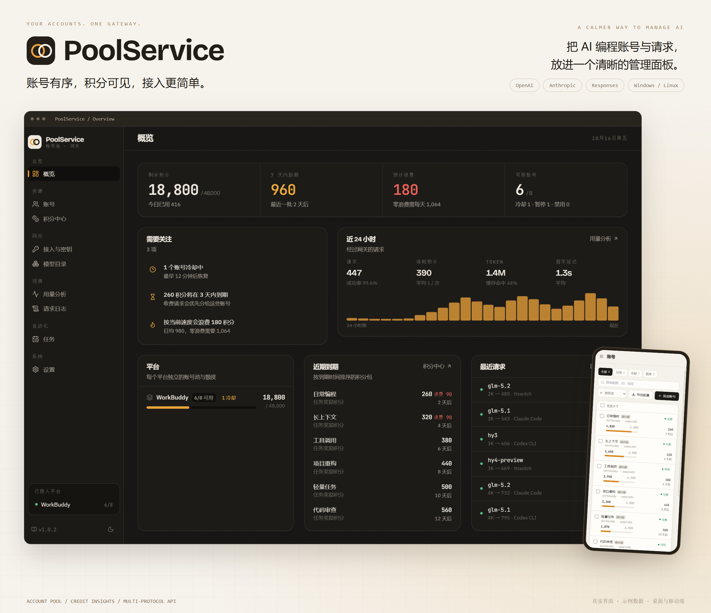
</p>

<p align="center"><strong>账号有序，积分可见，接入更简单。</strong></p>
<p align="center">把 WorkBuddy 账号聚合成统一的 AI 编程网关，用一个清晰的面板管理账号、积分与请求。</p>
<p align="center">
  <a href="https://github.com/OrangeCatYe/WorkBuddy2Api-PoolService/releases/latest">下载最新版</a> ·
  <a href="#界面导览">看看界面</a> ·
  <a href="#快速开始">快速开始</a> ·
  <a href="docs/API.md">API 文档</a> ·
  <a href="CHANGELOG.md">更新记录</a>
</p>
<p align="center"><sub>Windows / Linux · 单文件运行 · 三种 API 协议 · 明暗主题 · 移动端适配 · MIT</sub></p>

## 这是什么软件？

PoolService 是一个**运行在本机的账号池网关与 Web 管理面板**，不是聊天客户端，也不是账号售卖服务。把本人拥有的 WorkBuddy 账号加入池中后，就可以通过统一 API 接入 ttswitch、Claude Code 或 Codex CLI，并在浏览器里查看额度、管理账号和排查请求。

当前支持 **WorkBuddy 国内版 / 国际版**；多平台适配框架已就绪，其他平台尚未接入。

<p align="center">
  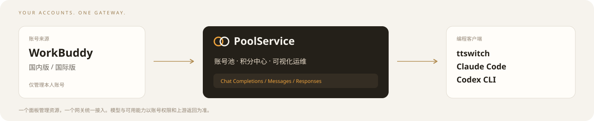
</p>

| 你关心的事 | PoolService 如何帮助你 |
|---|---|
| 账号多，状态不好掌握 | 统一查看可用、冷却、暂停状态，支持搜索、排序与批量操作 |
| 积分看不清，快到期才发现 | 完整数值显示、到期日历、消耗预测与到期优先调度 |
| 不同编程工具配置麻烦 | 同一网关提供三种 API 协议，面板内复制接入配置 |
| 请求消耗与失败原因不透明 | 请求日志与用量分析，按模型、账号、密钥、协议拆分 |
| 不想搭建复杂运行环境 | 下载、解压即可运行，前端已内嵌，无需安装 Go 或 Node.js |

> 基于 [workbuddy2api-panel](https://github.com/linguo2625469/workbuddy2api-panel)（MIT）重构。仅限管理本人账号使用，请遵守各平台服务协议。

## 界面导览

以下均为**当前前端实际渲染的界面**，使用独立、虚构的示例数据拍摄，不包含真实账号、凭证或个人用量。截图中的模型、倍率、余额与预测仅用于说明界面，实际以账号权限、上游目录及运行数据为准。点击图片可查看高清原图。

### 一眼掌握账号池的运行状态

概览把剩余积分、近期到期、预计浪费与可用账号放在最上方；需要关注的异常、近 24 小时请求趋势、近期积分包与最近请求集中展示，不必逐页寻找。

[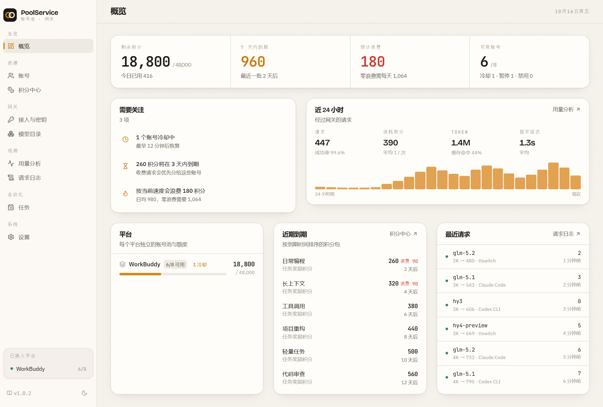](docs/images/overview-light.png)

### 把积分用在到期之前

积分中心不只展示余额，还提供 **30 天到期日历、账号消耗趋势与浪费预测**。到期优先策略可调节权重、每日上限和余额保底；选号回放让每次分配都有迹可循。

积分默认显示到整数个位，也可以在设置中切换为两位小数，不再用「万」隐藏小额消耗。

[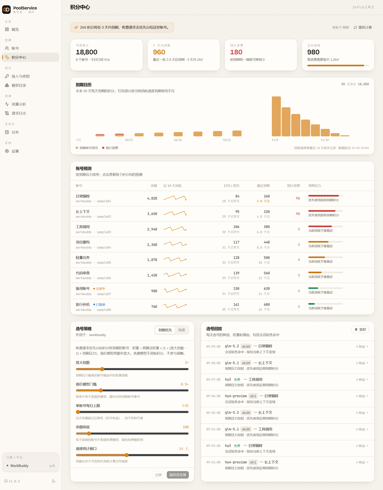](docs/images/credits.png)

### 账号管理与客户端接入，各有清晰入口

<table>
  <tr>
    <th width="50%">账号管理</th>
    <th width="50%">接入与密钥</th>
  </tr>
  <tr>
    <td><a href="docs/images/accounts.png">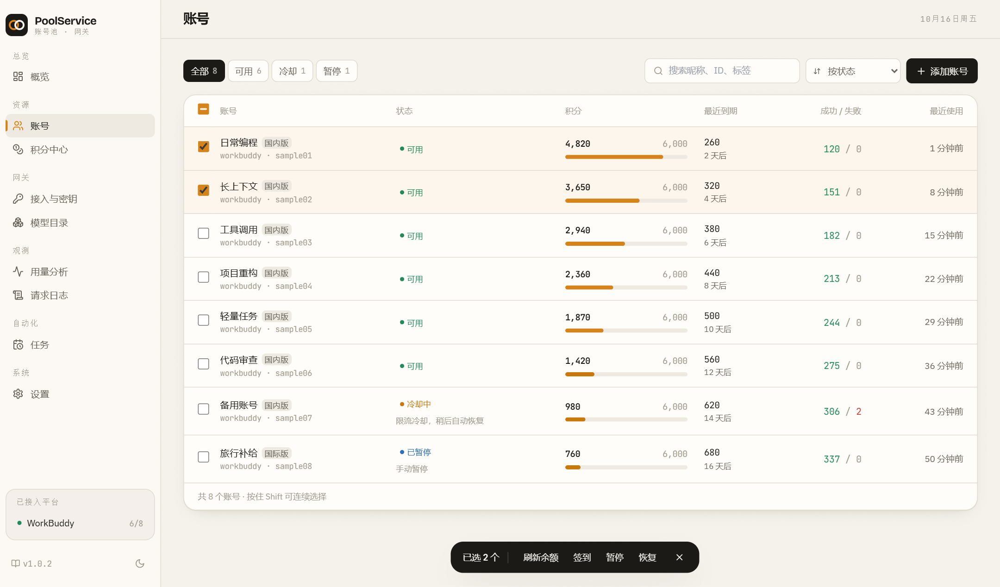</a></td>
    <td><a href="docs/images/gateway.png">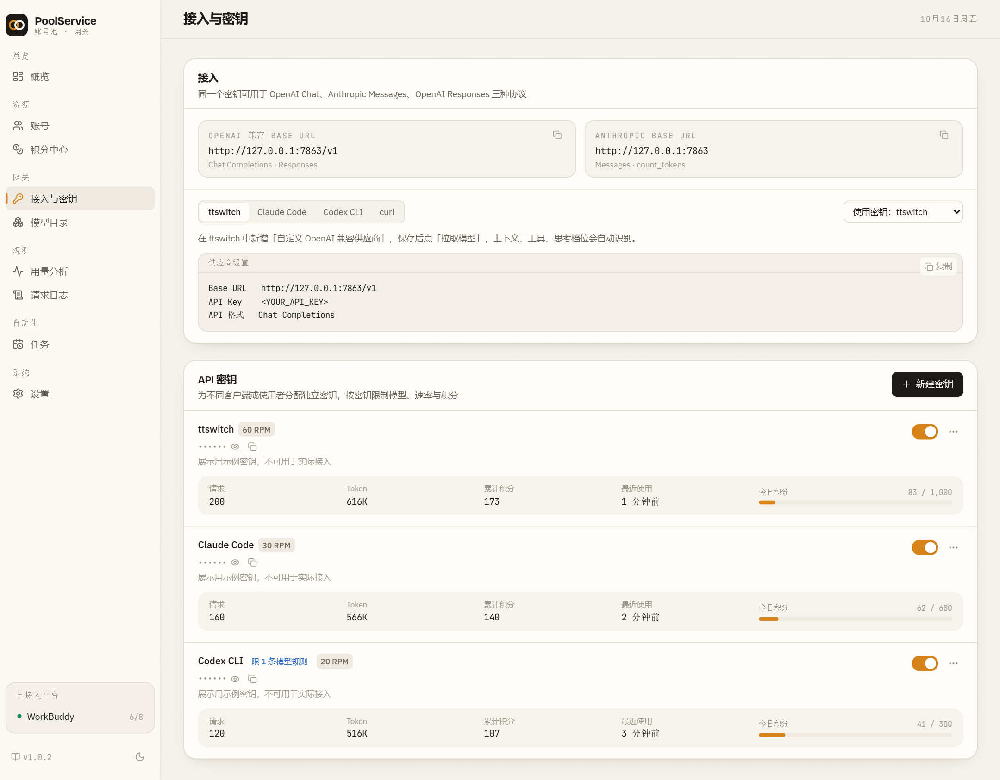</a></td>
  </tr>
  <tr>
    <td>按状态筛选、按余额或到期时间排序，批量刷新、签到、暂停、恢复与导出；点击账号查看详情。</td>
    <td>复制 ttswitch、Claude Code、Codex CLI 配置；按密钥限制模型、速率和积分预算。</td>
  </tr>
</table>

### 知道请求花在哪，也知道模型能做什么

<table>
  <tr>
    <th width="50%">用量分析</th>
    <th width="50%">模型目录</th>
  </tr>
  <tr>
    <td><a href="docs/images/usage.png">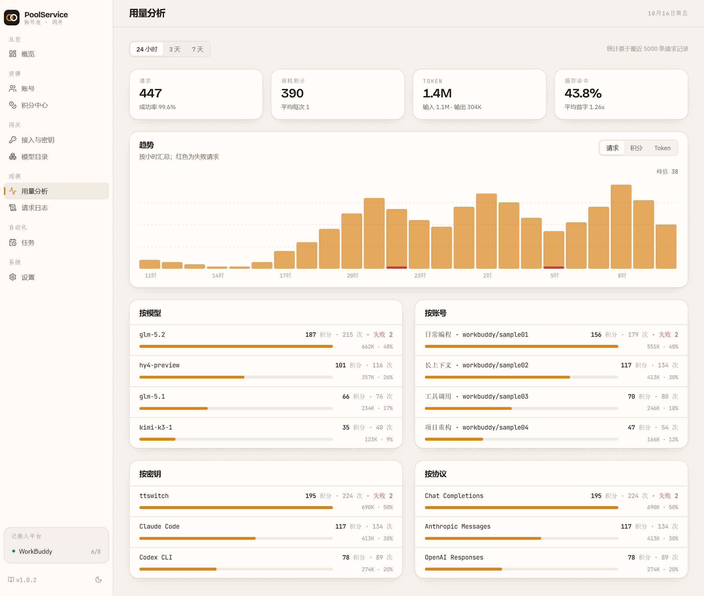</a></td>
    <td><a href="docs/images/models.png">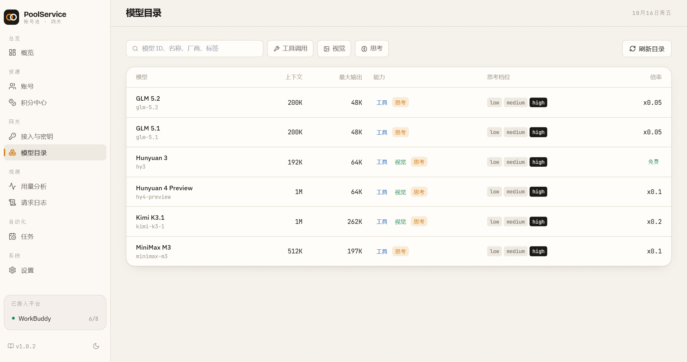</a></td>
  </tr>
  <tr>
    <td>查看成功率、缓存命中与首字延迟，按模型、账号、密钥和协议定位消耗来源。</td>
    <td>筛选工具调用、视觉与思考能力，对照上下文、最大输出和积分倍率选择模型。</td>
  </tr>
</table>

### 换机、重装或备份：导出配置，再导入

在账号页点击「导出配置」，勾选需要的账号，即可保存为一个 JSON 文件；也可以先在列表里多选，再点底部的「导出」。到另一台实例的「添加账号 → 导入凭证」中点「从文件载入」，提交后账号立即加入账号池。

<table>
  <tr>
    <th width="50%">导出配置</th>
    <th width="50%">导入配置</th>
  </tr>
  <tr>
    <td><a href="docs/images/export-dialog.png">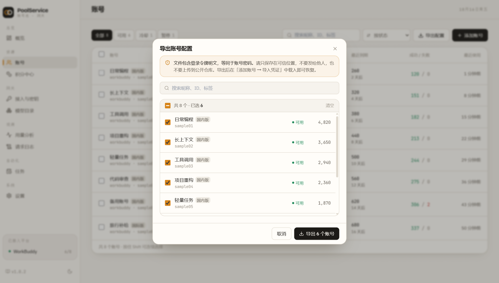</a></td>
    <td><a href="docs/images/import-dialog.png">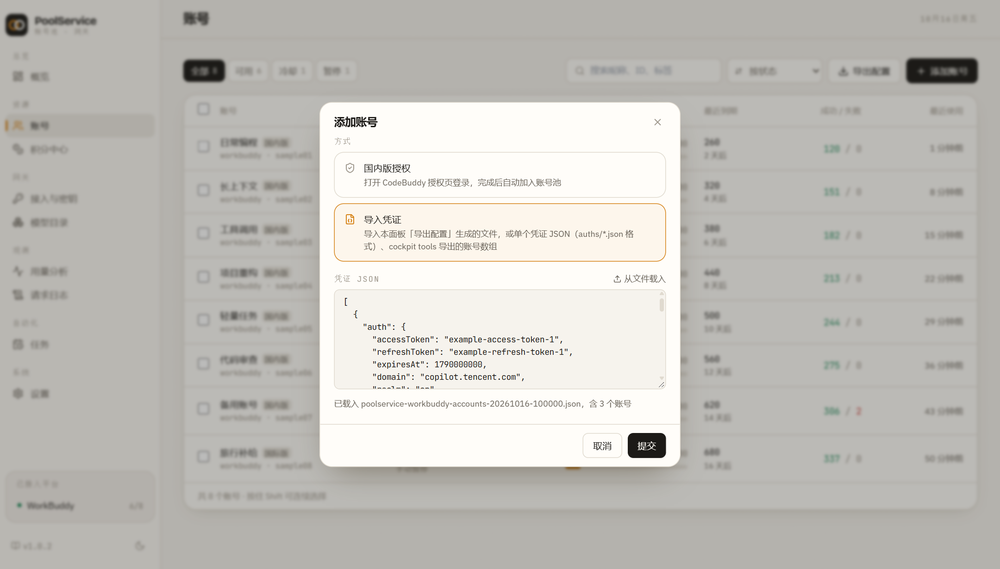</a></td>
  </tr>
  <tr>
    <td>可逐个勾选、搜索、全选或清空；按钮实时显示将导出几个账号。</td>
    <td>载入后显示文件名与账号数；池中已有更新的同一账号会自动跳过，不会被旧文件覆盖。</td>
  </tr>
</table>

> 导出文件**包含登录令牌明文，等同于账号密码**，请只保存在可信位置，不要发给他人或上传到公开仓库。为此，`admin_key` 为空时面板会拒绝导出。文件格式与 `auths/*.json` 一致，没有额外的私有格式。

<details>
<summary>查看深色主题与移动端界面</summary>

<p>浅色采用暖纸与琥珀配色，深色切换为深炭底色；窄屏使用抽屉导航和账号卡片列表。</p>
<p><a href="docs/images/overview-dark.png">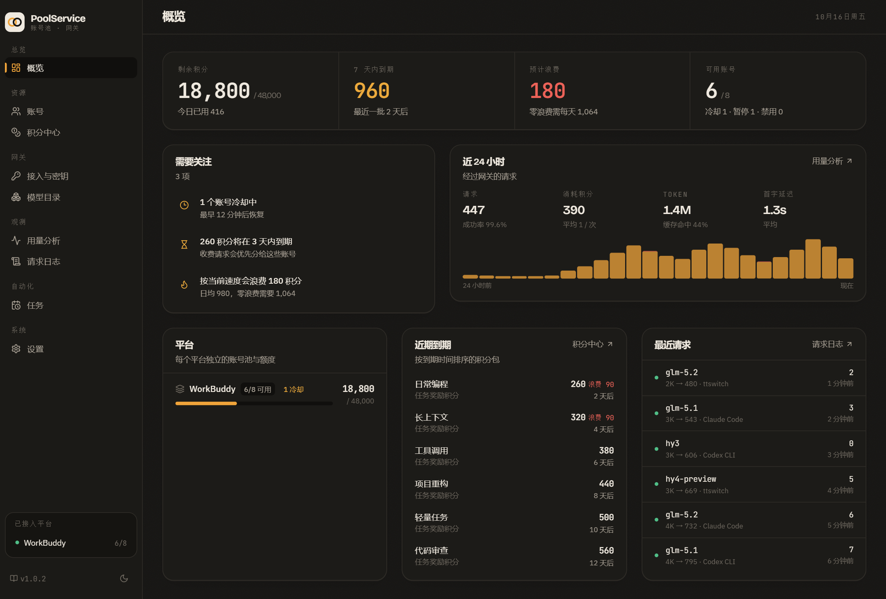</a></p>
<p align="center"><a href="docs/images/mobile-accounts.png">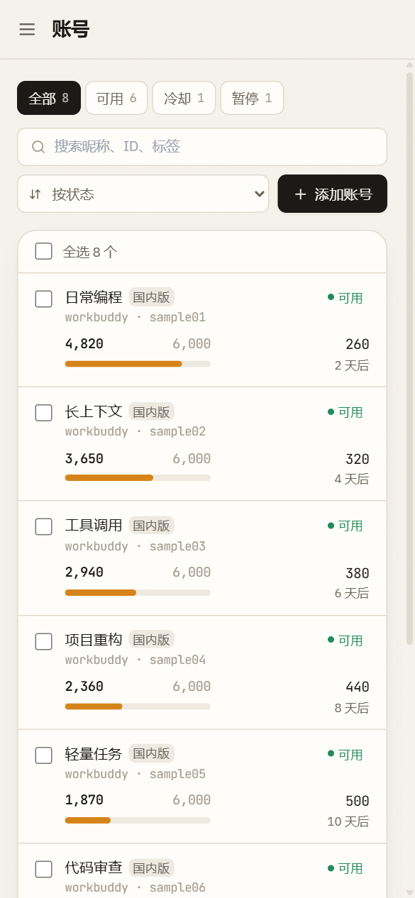</a></p>

</details>

## 功能

- **多平台框架**：平台以适配器接入，登录方式、账号操作、定时任务由适配器声明，面板自动渲染。当前支持 WorkBuddy（国内版 / 国际版）。
- **多协议网关**：OpenAI Chat Completions、Anthropic Messages、OpenAI Responses 三种入口，ttswitch、Claude Code、Codex CLI 都能直接接入；模型能力字段与 ttswitch 对齐，思考强度五档自动映射。
- **下游密钥**：按密钥限制模型、RPM 与每日 / 累计积分，独立统计用量。
- **账号导出与导入**：勾选账号导出为 JSON 文件，在「添加账号 → 导入凭证」载入即可恢复，方便换机、重装和备份；文件与 `auths/*.json` 同形态。导出内容含令牌明文，请妥善保管。
- **软件更新**：设置里检查新版本，下载后经签名与哈希校验，一键安装并自动重启，失败自动回滚；支持代理与自定义下载源。详见 [docs/UPDATE.md](docs/UPDATE.md)。
- **开机自启**：发布包附带 Windows 计划任务脚本与 Linux systemd 模板，由你主动安装。
- **请求日志与用量分析**：每个请求的账号、token、缓存命中、积分、耗时一目了然（不记录对话内容）。
- **积分中心**：预测每批积分到期前能否用完，按到期压力把收费请求优先分给快过期的账号，每次选号都能回放原因。详见 [docs/CREDITS.md](docs/CREDITS.md)。
- **积分显示精度**：完整显示积分，默认到个位；设置中可切换两位小数，全站即时联动。
- **模型名显示积分倍率**：可选在模型名后附加倍率，如 `glm-5.2(x0.05)`，在 Agent 里直接看到成本。
- **账号池**：沿用原项目的冷却、熔断、会话粘性、快过期积分优先等策略；签到、保活、猫猫旅行等定时任务。
- **Web 面板**：概览、账号（批量操作、积分包到期）、模型目录、任务、设置；明暗主题与移动端适配。

## 下载

从 [最新版 Release](https://github.com/OrangeCatYe/WorkBuddy2Api-PoolService/releases/latest) 下载对应平台压缩包，解压即可运行。

| 系统 | 下载文件 | 启动方式 |
|---|---|---|
| Windows x64 | `poolsvc-windows-amd64.zip` | 双击 `start.bat`，或运行 `poolsvc.exe` |
| Linux x64 | `poolsvc-linux-amd64.tar.gz` | 运行 `start.sh`，或执行 `./poolsvc` |

**无需额外配置环境**：压缩包内的二进制是静态编译的单文件可执行程序，前端页面已内嵌其中，不依赖 Go、Node.js、PHP 或任何外部运行时，也不安装任何依赖。

解压后目录内容：

```text
poolsvc-windows-amd64.zip  /  poolsvc-linux-amd64.tar.gz
├── poolsvc          主服务（Windows 为 poolsvc.exe）
├── migrate          旧版迁移工具（Windows 为 migrate.exe）
├── start.bat / start.sh    启动脚本
├── autostart/              开机自启（Windows 计划任务脚本 / Linux systemd 模板）
├── config.example.json     配置模板
├── README.md  LICENSE  CHANGELOG.md
```

启动：

```bash
cp config.example.json config.json
./poolsvc            # Windows 双击 start.bat 或运行 poolsvc.exe
```

压缩包附带 `.sha256` 校验文件：`sha256sum -c poolsvc-linux-amd64.tar.gz.sha256`。

## 快速开始

1. 从 [Release](https://github.com/OrangeCatYe/WorkBuddy2Api-PoolService/releases/latest) 下载并启动对应平台程序。
2. 打开面板 `http://127.0.0.1:7863`，输入启动日志中的面板管理密钥。
3. 在「账号 → 添加账号」选择「国内版授权」，在弹出的页面完成登录。已有其他实例导出的文件时，改选「导入凭证」→「从文件载入」即可。
4. 在「接入与密钥」创建 API Key，复制所用客户端的配置即可接入。

也可以自行构建：

```bash
# Windows
powershell -ExecutionPolicy Bypass -File scripts/build.ps1
# Linux
scripts/build.sh
```

首次运行自动生成 `config.json`，并在日志中打印面板管理密钥：

```bash
./bin/poolsvc -config config.json
# 面板: http://127.0.0.1:7863
```

## 软件更新与开机自启

在「设置 → 软件更新」检查新版本：下载后程序会用内置公钥验签、用清单里的 sha256 校验安装包，通过后点「安装并重启」即可。配置、数据和账号凭证不会被改动，更新前自动备份，新版本起不来会自动回滚。

[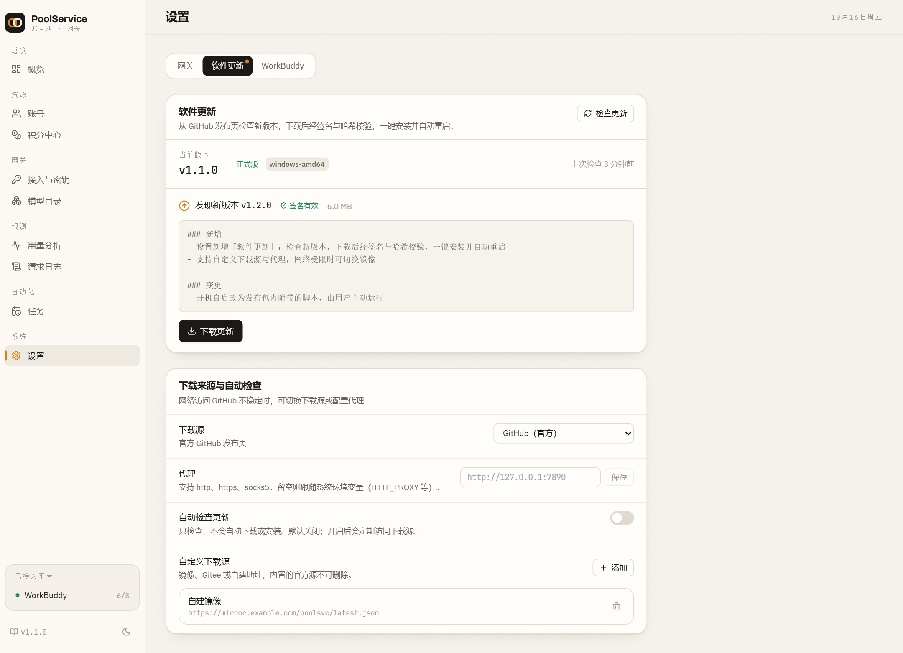](docs/images/update-panel.png)

- 网络访问 GitHub 不稳定时，可以配置代理，或添加镜像 / Gitee 等自定义下载源；镜像不需要被信任，内容照样验签。
- 自动检查默认关闭，开启后只检查、不会自动安装。
- 更新需要 `config.json` 里设置了 `admin_key`；从源码构建的开发版只提示新版本，不会被覆盖。
- v1.2.0 之前的版本没有此功能，第一次需要手动换包。

开机自启由你主动安装，程序本身不会写注册表或改启动项：

```powershell
# Windows：当前用户的计划任务，登录时后台启动，无需管理员权限
powershell -NoProfile -ExecutionPolicy Bypass -File autostart\windows.ps1 install -StartNow
```

Linux 请使用 `autostart/poolsvc.service`。安全模型、镜像搭建、手动回滚与排障见 [docs/UPDATE.md](docs/UPDATE.md)。

## 配置

```jsonc
{
  "listen": "127.0.0.1:7863",
  "data_dir": "./data",
  "admin_key": "adm-...",                 // 面板密钥
  "gateway": {
    "legacy_api_key": "sk-...",           // 下游 Agent 使用的 API Key
    "model_naming": "short",              // short / full / both
    "credit_in_model_name": false         // 模型名附加积分倍率
  },
  "update": {
    "source": "github",                   // 下载源，其余可在设置页添加
    "proxy": "",                          // 访问下载源的代理，空 = 跟随系统环境变量
    "auto_check": false,                  // 自动检查更新（只检查，不安装）
    "check_interval": "24h"
  },
  "providers": {
    "workbuddy": {
      "enabled": true,
      "auth_dir": "",                     // 空 = data/workbuddy/auths
      "pool": { "credit_floor": 100 },
      "schedule": { "checkin_hours": [9, 21] }
      // 其余字段与原 workbuddy2api-panel 的 config.json 同名同义
    }
  }
}
```

环境变量 `POOLSVC_LISTEN`、`POOLSVC_DATA_DIR`、`POOLSVC_ADMIN_KEY` 可覆盖对应字段。

## 接入 ttswitch

在 ttswitch 中新增「自定义 OpenAI 兼容供应商」：

| 项 | 值 |
|---|---|
| Base URL | `http://127.0.0.1:7863/v1` |
| API Key | `gateway.legacy_api_key` |
| API 格式 | Chat Completions |

拉取模型列表后，上下文长度、最大输出、图片输入、工具调用、思考档位会自动识别。思考强度按 ttswitch 的 `low / medium / high / xhigh / max` 发送，网关映射到模型实际支持的档位，并在响应头 `X-Reasoning-Effort-Applied` 中给出实际档位。

## 接入 Claude Code / Codex CLI

面板「接入与密钥」页提供可直接复制的配置片段。简要说明：

```bash
# Claude Code（Anthropic Messages）
export ANTHROPIC_BASE_URL="http://127.0.0.1:7863"
export ANTHROPIC_AUTH_TOKEN="sk-pool-..."
export ANTHROPIC_MODEL="glm-5.2"
```

```toml
# Codex CLI（~/.codex/config.toml，Responses 协议）
model = "glm-5.2"
model_provider = "poolservice"

[model_providers.poolservice]
name = "PoolService"
base_url = "http://127.0.0.1:7863/v1"
wire_api = "responses"
env_key = "POOLSVC_API_KEY"
```

协议转换的能力边界见 [docs/API.md](docs/API.md)。

## 从 workbuddy2api-panel 迁移

Release 压缩包内自带迁移工具 `migrate`（与 `poolsvc` 一起发布，静态编译、**无需安装 Go 环境**），一条命令完成迁移。旧版目录指到 v1.x 的解压目录：

```bash
# 先看看会做什么，不写文件
./migrate -from /path/to/wb2api-panel-v1.11.7-windows-amd64 -dry-run

# 确认无误后实际执行（Windows 用 migrate.exe）
./migrate -from /path/to/wb2api-panel-v1.11.7-windows-amd64
```

从源码构建时使用方式相同，把 `./migrate` 换成 `go run ./cmd/migrate` 即可。

工具会把旧版 `auths/` 下的凭证与 `data/state.json` 里的运行态（余额、禁用、冷却、统计、模型冷却、成本账本）一并迁入，迁移前自动备份现有 `auths` 与 `state.json` 到 `data/backup/`。同 UID 已存在时保留令牌较新的一方，避免用过期凭证覆盖有效凭证；加 `-force` 改为旧版无条件覆盖。

迁移后重启服务生效。旧版客户端使用的 `cn:glm-5.2` 这类模型名仍然可用。

手工迁移（工具不适用时）参照：

1. 把旧项目的 `auths/` 目录复制到 `data/workbuddy/auths/`，或在配置中设置 `providers.workbuddy.auth_dir` 指向旧目录。
2. 可选：把旧 `data/state.json` 复制到 `data/workbuddy/state.json`，保留冷却与统计状态。
3. 旧 `config.json` 中的 `pool`、`schedule`、`upstream`、`global`、`prompt` 等段落原样放进 `providers.workbuddy`。

## 开发

```bash
npm --prefix web install
npm --prefix web run dev          # 前端开发服务器，代理到 127.0.0.1:7863
go test ./...
```

打 `v*` 标签会自动触发 Release 工作流，交叉编译 Windows / Linux 产物并上传。日常提交只运行 CI（gofmt、vet、带竞态检测的测试、前端构建），不会产生 Release。

提交前可先跑本地预检，覆盖 CI 除竞态检测外的全部检查，十几秒出结果，不必等远端：

```powershell
powershell -NoProfile -ExecutionPolicy Bypass -File scripts/precheck.ps1          # 全量，约 15s
powershell -NoProfile -ExecutionPolicy Bypass -File scripts/precheck.ps1 -Quick   # 快速，约 5s，跳过 go test 与前端构建
```

唯一跑不了的是 `go test -race`：它需要 C 编译器（gcc），本机没有，由 CI 补齐。遇到并发相关的改动，仍需看一次 CI 结果。

- 需求：[docs/REQUIREMENTS.md](docs/REQUIREMENTS.md)
- 架构：[docs/ARCHITECTURE.md](docs/ARCHITECTURE.md)
- 软件更新：[docs/UPDATE.md](docs/UPDATE.md)
- 后续开发规则：[docs/DEVELOPMENT.md](docs/DEVELOPMENT.md)
- 分支与版本管理：[docs/BRANCHING.md](docs/BRANCHING.md)
- 新平台接入：[docs/PROVIDER_GUIDE.md](docs/PROVIDER_GUIDE.md)
- 界面素材维护：[docs/SHOWCASE.md](docs/SHOWCASE.md)
- 变更记录：[CHANGELOG.md](CHANGELOG.md)
