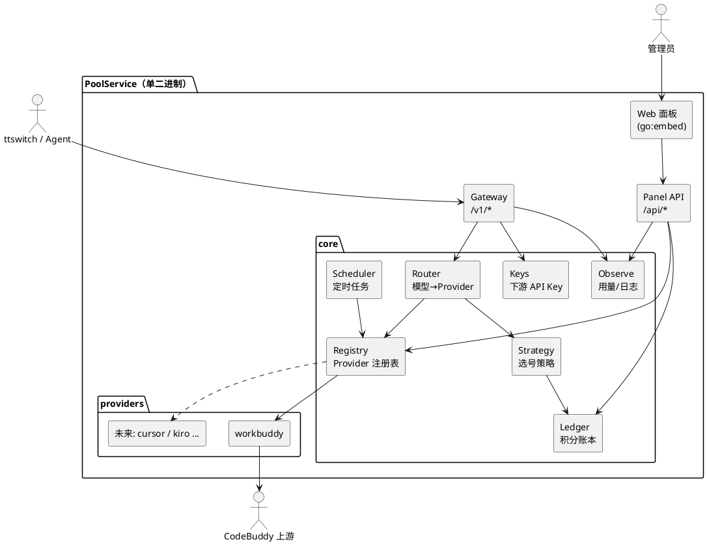
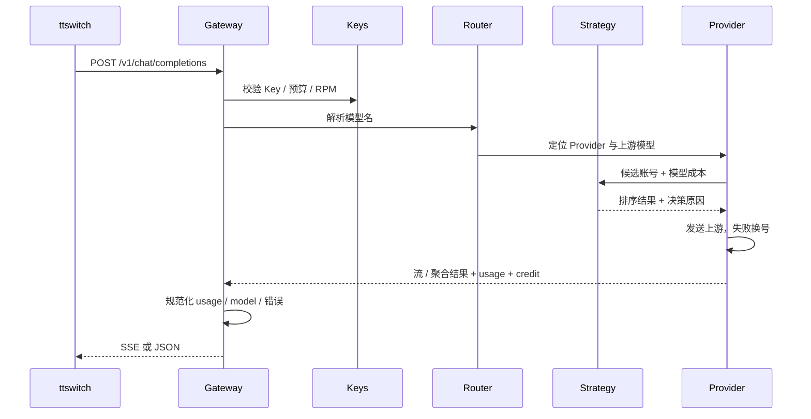
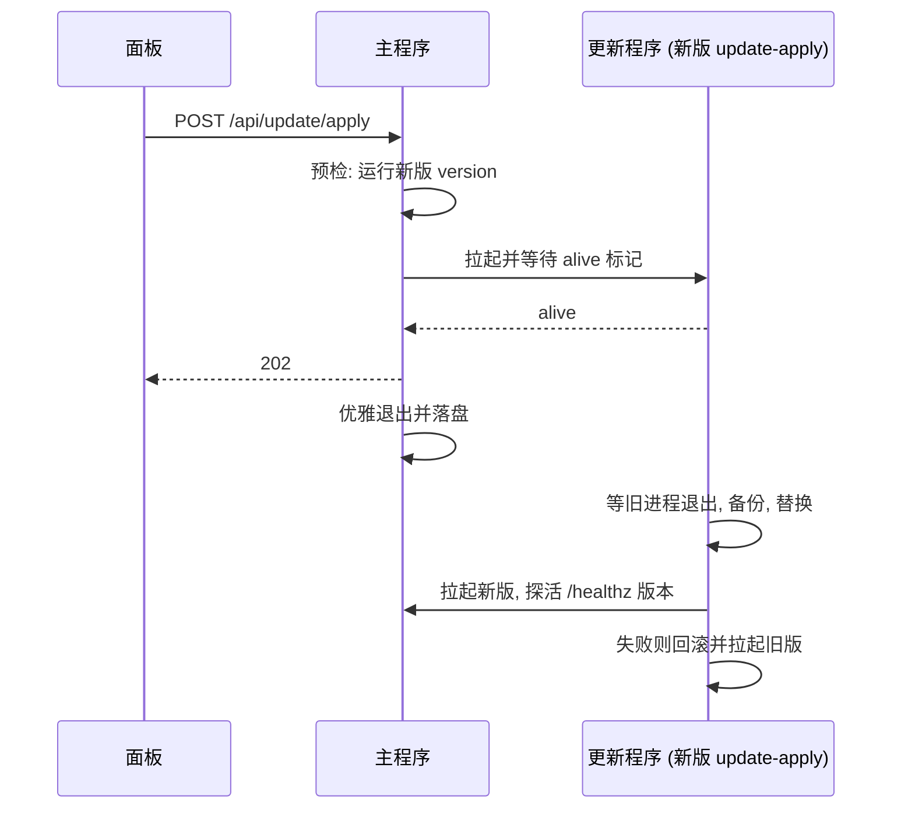

# PoolService 架构设计

## 1. 总览



## 2. 目录结构

```text
cmd/poolsvc/            主程序入口
internal/
  app/                  装配：配置加载、依赖注入、生命周期
  config/               配置结构、默认值、环境变量覆盖、原子写
  core/
    provider/           Provider 能力接口与注册表
    account/            统一账号模型与状态机
    ledger/             积分账本、积分包、消耗速度与预测
    strategy/           选号策略（EDF / 配速 / 成本 / 保底），决策可解释
    router/             模型目录聚合、模型名解析
    keys/               下游 API Key、预算、限速
    observe/            请求日志、用量聚合
    scheduler/          通用定时任务（Provider 注册任务）
  gateway/              OpenAI 兼容入口（chat / models / 错误规范）
  panelapi/             面板 REST API
  providers/
    workbuddy/          WorkBuddy 适配器（迁入原项目协议层）
  webui/                go:embed 前端产物
web/                    前端源码（React + TS + Vite）
docs/                   文档
```

## 3. Provider 能力接口

Provider 以「基础接口 + 可选能力接口」组合，核心通过类型断言发现能力，面板据此渲染。

```go
type Provider interface {
    Meta() Meta                    // id、名称、图标、能力清单
    Accounts() []Account           // 当前账号快照（统一模型）
}

type ChatCapable interface {
    Models(ctx) ([]Model, error)
    Chat(ctx, req *ChatRequest, pick Picker) (*ChatResult, error)
}

type QuotaCapable interface {   // 额度 / 积分包
    RefreshQuota(ctx, accountID) (Quota, error)
}

type LoginCapable interface {   // 添加账号
    LoginMethods() []LoginMethod
    StartLogin(ctx, method, params) (LoginSession, error)
    PollLogin(ctx, sessionID) (LoginStatus, error)
}

type AccountOps interface {     // 启用 / 禁用 / 暂停 / 移除 / 自定义动作
    Actions() []ActionDef
    Do(ctx, accountID, action, params) (ActionResult, error)
}

type TaskCapable interface {    // 定时任务 / 成长任务
    ScheduledTasks() []TaskDef
    RunTask(ctx, taskID, accountIDs) error
}
```

`Picker` 由核心注入：Provider 提供候选账号与请求上下文，核心 Strategy 做排序决策，Provider 负责实际发送与错误归类（错误归类回写账号状态）。这样选号策略对所有平台统一，而平台特有的错误语义留在适配器里。

## 4. 请求链路



## 5. 积分账本与策略

账号积分以「积分包」建模：

```text
Package{ amount, remaining, expire_at, source(签到/任务/购买/企业周期) }
```

指标：

- `burn_rate`：近 1h / 24h 消耗速度（积分 / 小时）
- `waste_forecast`：到期前按当前分摊速度仍用不完的积分
- `depletion_at`：按当前速度耗尽时间
- `next_refill_at`：下次签到 / 周期重置

选号评分（每项可配置权重，结果附原因）：

```text
score = w_edf * 浪费风险(urgency)
      + w_pace * (1 - 实际速度 / 目标速度)
      + w_balance * 余额比例
      + w_idle * 闲置补偿
过滤：禁用 / 冷却 / 在途占满 / 低于 floor 且模型收费
```

## 6. 前端

- React 18 + TypeScript + Vite + Tailwind CSS
- 路由：React Router；数据：TanStack Query（轮询 + 缓存）；图表：ECharts
- 组件：自建轻量 UI 组件库（Button / Card / Table / Drawer / Dialog / Badge / Tabs / Toast），统一设计令牌（颜色、圆角、间距），明暗主题
- 构建产物输出到 `internal/webui/dist`，由 Go `embed` 打包

## 7. 软件更新

```text
internal/update/        检查（latest.json + 签名）、下载与校验、安全解压、更新程序（备份 / 替换 / 拉起 / 探活 / 回滚）
internal/sysproc/       平台相关：等待 / 结束进程、脱离父进程拉起、控制台判断（Windows 与类 Unix 各一份）
internal/logfile/       带滚动的日志文件（无控制台时使用）
cmd/updatectl/          发布侧工具：生成密钥、清单、签名、验签
```



更新程序是新版本自己的二进制，因此替换逻辑永远是最新的，也不需要随包分发额外的可执行文件。
由 systemd 等服务管理器托管时，更新程序作为子进程会随服务的 cgroup 一并被清理，所以改为主进程自己替换文件后退出，由服务管理器重启。

## 8. Git 约定

- `main`：稳定分支；每阶段在 `feat/*` 开发，完成后 `--no-ff` 合并
- 提交信息：Conventional Commits，如 `feat(gateway): 输出 ttswitch 兼容的模型字段`
- 每次合并前：`go build ./... && go test ./...`，前端 `npm run build`
