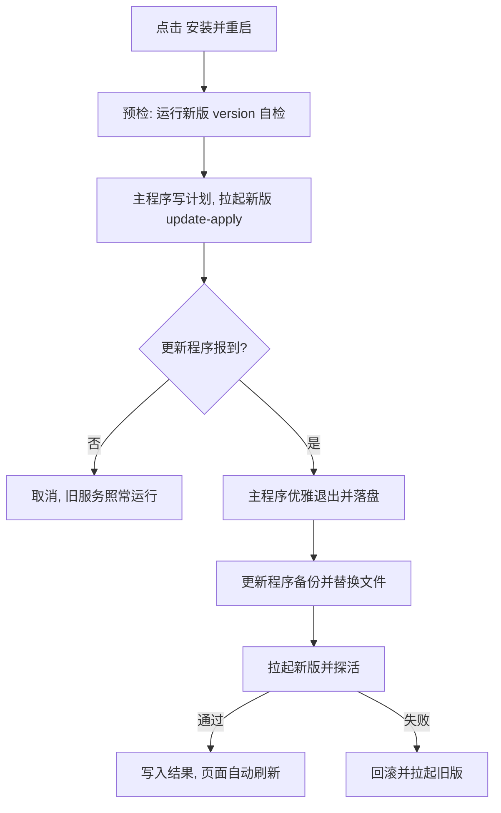

# 软件更新

在「设置 → 软件更新」里检查 GitHub 上有没有新版本，下载后经签名与哈希校验，一键安装并自动重启。
设计取舍见[提案](proposals/2026-10-19-remote-update.md)，接口见 [API.md](API.md#软件更新)。

## 怎么用

1. 打开「设置 → 软件更新」，点「检查更新」。有新版本时标签上会出现提示点。
2. 看一眼更新说明，点「下载更新」。下载完成会显示「已下载并通过校验」。
3. 点「安装并重启」，确认。服务会停几秒到十几秒，页面等服务回来后自动刷新到新版本。

注意：

- 安装会**中断进行中的流式请求**，客户端需要重试。建议在没有重要任务时做。
- 账号、密钥、配置和历史数据不会被改动，更新前会自动备份。新版本起不来会自动回滚。
- 需要 `config.json` 里设置了 `admin_key`（空密钥意味着面板无鉴权，任何人都能触发更新）。
- 只有 `vX.Y.Z` 形式的正式版能自动更新。从源码构建的开发版（版本号形如 `v1.1.0-3-gabc123` 或 `dev`）只提示新版本，不会被覆盖。
- v1.2.0 之前的版本没有这个功能，第一次需要手动换包。

自动检查默认关闭。开启后每隔设定时间（最短 1 小时）访问下载源，**只检查，不会自动下载或安装**。

## 安全模型

| 威胁 | 怎么防 |
|---|---|
| 下载源被替换成假程序 | 更新清单 `latest.json` 带 ed25519 签名，程序用**内置公钥**验签；清单里记录安装包的 sha256，下载后逐字节核对。换成任何镜像都无法伪造 |
| 签名被剥掉后降级成「无签名」 | 有签名但验不过 = 直接拒绝；没有签名文件 = 只提示新版本、**不允许自动安装** |
| 把旧版本当新版本推给你 | 只接受严格高于当前的版本，相同或更低一律视为已最新 |
| 安装包里夹带路径穿越 | 解压只放行白名单文件名，拒绝 `..`、绝对路径、符号链接，并限制单文件与总体积 |
| 接口被拿来访问任意地址 | 请求只能给下载源 ID，地址只来自配置文件，且只接受 https（本机回环除外） |
| 未鉴权的面板被远程触发更新 | `admin_key` 为空时下载、安装、改设置一律拒绝 |
| 新程序跑不起来导致服务挂掉 | 停止旧服务**之前**先运行新程序的 `version` 子命令自检；替换后探活失败自动回滚 |

边界：签名私钥与 GitHub 仓库账号属于同一个信任域，账号被盗时签名也可能被伪造。签名防的是镜像、代理和中间人，不是仓库本身被攻破。

## 更新过程



要点：

- 更新程序就是新版本自己的 `poolsvc update-apply`，不另带可执行文件，也不在运行时生成任何脚本。
- 旧进程先自己退出（最多等 30 秒），超时才强制结束，避免丢最近几秒未落盘的运行状态。
- 更新程序没起来就**不退出旧服务**，不会出现「服务停了、更新也没发生」。
- 探活要求新进程持续存活，且 `/healthz` 连续报告新版本号。账号池为空时 `/healthz` 返回 503，这不算失败。

### 哪些文件会被替换

| 文件 | 处理 |
|---|---|
| `poolsvc(.exe)`、`migrate(.exe)` | 覆盖 |
| `README.md`、`LICENSE`、`CHANGELOG.md`、`config.example.json` | 覆盖 |
| `autostart/` 下的自启文件 | 覆盖 |
| `start.bat` / `start.sh` | **只在缺失时补**，你改过的不动 |
| `config.json`、`data/`、`auths/` 及其他任何文件 | **绝不触碰** |

主程序改过文件名也没关系，更新会替换当前正在运行的那个文件。

### 重启后的窗口

| 你原来怎么运行 | 更新后 |
|---|---|
| 在控制台里运行（双击 `start.bat`） | 新开一个控制台窗口，日志照常显示 |
| `poolsvc -background` 或开机自启 | 无窗口，日志写入 `data/logs/poolsvc.log` |
| Linux 被 systemd 管理 | 主进程自己替换文件后退出，由 systemd 重启 |

## 下载源与代理

默认源是官方 GitHub 发布页，检查更新走 `releases/latest/download/latest.json` 直链，不经过 GitHub API，因此不占匿名 API 每小时 60 次的额度。

网络访问 GitHub 不稳定时：

- **配置代理**：设置页填 `http://127.0.0.1:7890` 或 `socks5://...`。留空则跟随系统环境变量 `HTTP_PROXY` / `HTTPS_PROXY`。
- **换下载源**：在设置页添加自定义源（镜像、Gitee、自建），然后选中它。

自定义源由三项组成：

| 项 | 说明 |
|---|---|
| 名称 | 下拉框里显示的名字 |
| 清单地址 | `latest.json` 的 https 地址；签名文件地址是它后面加 `.sig` |
| 安装包地址模板 | 可用 `{tag}`（如 `v1.2.0`）、`{version}`（如 `1.2.0`）、`{name}`（安装包文件名，**必须包含**） |

搭一个镜像只需要把 Release 里的 `latest.json`、`latest.json.sig` 和安装包原样放到任意 https 地址。镜像**不需要被信任**：内容仍会用内置公钥验签、用清单里的 sha256 校验。

配置文件里的写法（设置页保存后会写入）：

```json
"update": {
  "source": "gitee",
  "proxy": "",
  "auto_check": false,
  "check_interval": "24h",
  "sources": [
    {
      "id": "gitee",
      "name": "Gitee 镜像",
      "manifest_url": "https://gitee.com/you/poolsvc/raw/main/latest.json",
      "asset_url": "https://gitee.com/you/poolsvc/releases/download/{tag}/{name}"
    }
  ]
}
```

## 开机自启

自启项由你主动安装，主程序和更新程序都不会写注册表、创建计划任务或改动启动项。

**Windows**：发布包里的 `autostart\windows.ps1` 会创建一个当前用户的计划任务，登录时运行 `poolsvc.exe -background`。不需要管理员权限。

```powershell
powershell -NoProfile -ExecutionPolicy Bypass -File autostart\windows.ps1 install -StartNow
powershell -NoProfile -ExecutionPolicy Bypass -File autostart\windows.ps1 status
powershell -NoProfile -ExecutionPolicy Bypass -File autostart\windows.ps1 uninstall
```

`-background` 会释放控制台窗口并把日志写进 `data/logs/poolsvc.log`（单个 5 MB，保留 3 份历史）。登录时控制台可能闪一下。卸载只删除计划任务，不会停掉正在运行的服务。

**Linux**：把 `autostart/poolsvc.service` 复制到 `/etc/systemd/system/`，按文件头部注释改路径和用户，然后 `systemctl enable --now poolsvc`。服务用户需要对安装目录有写权限，否则一键更新会提示无法使用。

## 出问题怎么办

| 现象 | 处理 |
|---|---|
| 提示「无法连接下载源」 | 检查网络；配置代理或换下载源 |
| 提示「没有找到更新清单（latest.json）」 | 版本正在发布中（几秒空窗），或该镜像尚未同步，稍后重试 |
| 提示「签名校验失败」 | 下载源内容被改过，或不是官方发布。换回官方源，不要继续 |
| 提示「未签名，不允许自动安装」 | 该版本发布时没有配置签名密钥，请到发布页手动下载 |
| 提示「新版本程序无法运行」/「更新程序没有响应」 | 多半是被安全软件拦截。把安装目录加入排除项后重试，或手动安装 |
| 更新后页面显示「已自动回滚」 | 新版本没能起来，已恢复旧版本。原因见 `data/update/apply.log` |
| 想手动回滚 | 停止服务，把 `data/update/backup/<旧版本>-<时间>/files/` 里的文件复制回安装目录；`extra/` 里是更新前 `config.json` 和各平台 `state.json` 的副本 |

排查日志：

- `data/update/apply.log`：每次更新的完整过程
- `data/logs/poolsvc.log`：后台运行时的服务日志
- `data/update/backup/`：最近 3 次更新前的文件备份

回滚到旧版本后，如果新版本已经迁移过数据，旧版本不保证能读取新格式。

## 发版者须知

发版时流水线会生成并签名 `latest.json`：

1. 在 GitHub 仓库 Settings → Secrets and variables → Actions 里添加 Secret `UPDATE_SIGNING_KEY`，值为私钥文件内容（一行 base64）。
2. 私钥对应的公钥内置在 `internal/update/keys.go`。流水线会用内置公钥再验一遍：**Secret 里的私钥与代码里的公钥不是一对时，发布会失败**，不会发出所有客户端都验不过的签名。
3. 没有配置 Secret 时发布照常完成，但只带警告：没有签名，客户端只会提示新版本，不允许一键安装。

生成密钥对（只需一次，私钥保存在仓库之外）：

```bash
go run ./cmd/updatectl keygen -out ~/.poolsvc-update-signing
```

`updatectl` 的其他子命令：

| 命令 | 用途 |
|---|---|
| `manifest -dir <产物目录> -tag vX.Y.Z -changelog CHANGELOG.pub.md -out latest.json` | 根据安装包生成清单，更新说明取自变更记录对应版本小节 |
| `sign -in latest.json -out latest.json.sig` | 用环境变量 `UPDATE_SIGNING_KEY` 签名 |
| `verify -in latest.json -sig latest.json.sig` | 用内置公钥验签 |

**轮换密钥**：先把新公钥加入 `trustedKeys`（可以同时放多把）并随一个版本发出去，等用户升级后再改用新私钥签名。直接换掉公钥会让旧版本验不过新签名，只能手动换包。

**不要覆写已发布的版本**。同一标签重发时 Release 会先删后建，中间有几秒空窗，客户端这时会看到「没有找到更新清单」。
