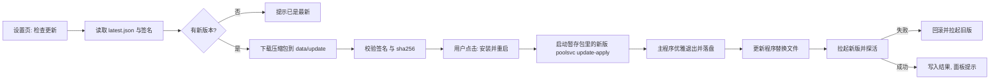

# 提案：远程检查更新与一键更新

日期：2026-10-19　状态：已实现（结论已并入 [REQUIREMENTS.md](../REQUIREMENTS.md) §3.7，使用说明见 [UPDATE.md](../UPDATE.md)）

## 背景

发布后用户只能手动去 GitHub 下载压缩包、停服务、覆盖文件、再启动，既不知道有没有新版本，也容易覆盖掉自己改过的文件。目标是在「设置」里提供：检查更新、下载、一键安装并重启，并且：

- 不引入杀毒软件容易报毒的行为
- 国内网络不稳定时可切换下载源
- 不能因为更新失败把服务搞坏，失败要能回滚
- 用户目前用 `start.bat` 启动，希望有开机自启的方案

## 现状约束

| 事实 | 对设计的影响 |
|---|---|
| Windows 不能覆盖或删除正在运行的 exe，但可以重命名 | 必须由另一个进程在主程序退出后做替换 |
| `start.bat` 只有一行 `poolsvc.exe`，没有守护循环 | 主程序退出后没人拉起，重启必须由更新程序负责 |
| GitHub 匿名 API 每小时 60 次，同出口 IP 容易耗尽 | 不使用 API，改读 Release 里的 `latest.json` |
| `releases/latest/download/<文件>` 可匿名访问且不占 API 额度 | 检查与下载都走这类直链 |
| 现有 `.sha256` 与压缩包同处一个 Release | 只能防损坏，防不了镜像或中间人篡改，需要签名 |
| 网关 `/healthz` 无需鉴权，空池时返回 503 | 更新后的探活不能只看 200 |
| `data_dir` 默认是相对 cwd 的 `./data` | 暂存目录不能假设和安装目录同卷，替换时要「同目录写临时文件再改名」 |

## 方案总览



## 一、发布侧：`latest.json` 与签名

Release 工作流新增两个产物：`latest.json`、`latest.json.sig`。

```json
{
  "schema": 1,
  "version": "1.2.0",
  "tag": "v1.2.0",
  "published_at": "2026-10-20T10:00:00Z",
  "notes": "取自脱敏后的 CHANGELOG 当前版本段",
  "assets": {
    "windows-amd64": { "name": "poolsvc-windows-amd64.zip", "size": 12345678, "sha256": "..." },
    "linux-amd64":   { "name": "poolsvc-linux-amd64.tar.gz", "size": 12345678, "sha256": "..." }
  }
}
```

- `latest.json` 里只写文件名，不写完整 URL。URL 由「下载源」模板拼出，这样同一份清单可以放到任何镜像。
- 用 ed25519 对 `latest.json` 字节签名，私钥放 GitHub Secret `UPDATE_SIGNING_KEY`，公钥编进二进制（支持多把公钥，便于轮换）。
- 因为 `latest.json` 内含各平台压缩包的 sha256，验过签名就等于验过压缩包，镜像再不可信也无法替换内容。
- 没有配置私钥时工作流不失败，只是不产出签名；客户端对「无签名」的版本只提示、不允许自动安装。
- 拒绝降级：版本号必须严格大于当前版本，否则忽略。
- 同标签重发会先删后建，存在几秒空窗，检查失败一律当作「暂无更新」，不报红。

## 二、下载源

`config.json` 新增可选段（全部有默认值，老配置不受影响）：

```json
"update": {
  "source": "github",
  "sources": [],
  "proxy": "",
  "auto_check": false,
  "check_interval": "24h"
}
```

内置源 `github`：

- 清单：`https://github.com/OrangeCatYe/WorkBuddy2Api-PoolService/releases/latest/download/latest.json`
- 文件：`https://github.com/OrangeCatYe/WorkBuddy2Api-PoolService/releases/download/v{version}/{name}`

自定义源（用户或后续版本追加）由三种形态覆盖，统一表示为 `{id, name, manifest_url, asset_url}` 模板：

- 前缀代理：把原 GitHub URL 拼在代理地址后面
- 镜像站或 Gitee：把 `latest.json` 与压缩包放到另一个地址
- 自建地址

约束：

- 只接受 `https`（本机回环地址仅测试用）
- 请求体不能直接传 URL，只能传源 ID，URL 只能来自配置文件，避免接口被用来访问任意地址
- 清单和压缩包可以走不同源，但都要过同一套签名与哈希校验
- 代理：默认读系统环境变量，另支持 `update.proxy` 显式指定（http / https / socks5）
- 本次只内置 `github`，其余源由用户在设置里添加；后续版本再预置常用镜像

## 三、更新流程与更新程序

### 为什么不是「主程序自己覆盖自己」

主程序不能替换自己，而且需要先把 `state.json` 等运行态落盘再退出。所以由一个独立进程接力。

### 更新程序的形态

更新程序就是**新版本压缩包里的 `poolsvc` 自己**，以子命令运行：`poolsvc update-apply --plan <plan.json>`。

- 从暂存目录里的新版本启动，因此更新逻辑永远是最新的，也能顺带更新旧版更新程序自己
- 不新增单独的可执行文件，也不在运行时生成任何脚本

### 执行步骤

1. 前置检查：版本号是正式版（`vX.Y.Z`）；安装目录可写；已通过签名与哈希校验；`admin_key` 非空。
2. 主程序写 `plan.json`（PID、可执行文件路径、原启动参数、工作目录、监听地址、重启方式、新旧版本），然后以脱离父进程的方式拉起暂存包里的新版 `update-apply`。
3. 主程序返回 202，并触发现有的优雅退出流程（关 HTTP、停 Provider、落盘）。
4. 更新程序等待旧进程退出，**优先让它自己退出**，超过 30 秒才强制结束。强制结束可能丢最近几秒未落盘的运行态，所以只做兜底。
5. 备份：把将被替换的文件、`config.json`、`state.json` 复制到 `data/update/backup/<旧版本>/`。
6. 替换：对每个文件先在目标目录写 `xxx.new`，再改名覆盖；遇到被杀毒软件扫描占用时按退避重试。任何一步失败按逆序回滚。
7. 拉起新版：沿用原参数与工作目录。
8. 探活：监听端口可连通，且 `/healthz` 返回带 `service` 标识的响应（不要求 200，空池 503 也算服务已起来），新进程持续存活。
9. 探活失败：结束新进程，恢复备份，拉起旧版。
10. 写 `data/update/result.json`，新进程启动后读取并在面板提示「已更新」或「更新失败已回滚」，然后清理暂存。

### 替换哪些文件

| 文件 | 策略 |
|---|---|
| `poolsvc(.exe)`、`migrate(.exe)` | 覆盖 |
| `README.md`、`LICENSE`、`CHANGELOG.md`、`config.example.json` | 覆盖 |
| `start.bat` / `start.sh` | **不覆盖**，仅在缺失时补；用户可能改过 |
| `config.json`、`data/`、`auths/` 及其他用户文件 | **绝不触碰** |

### 重启方式

| 场景 | 做法 |
|---|---|
| `start.bat` 控制台启动 | 在新控制台窗口拉起，和原来一样能看到日志 |
| 无控制台（开机自启） | 无窗口拉起，日志写文件 |
| Linux 非守护运行 | 新会话拉起 |
| Linux 被 systemd 管理 | 退出前先改名替换二进制，再由 systemd 重启；不自行拉起，避免端口冲突 |

## 四、避免杀毒误报

无法保证零误报，但避开最典型的恶意行为特征，并给出降级路径：

1. 不在运行时生成或执行 `.bat`、`.ps1`、`.vbs`，不调用 `cmd /c`、`powershell`。
2. 不使用 `%TEMP%`，下载、解压、执行都在 `data/update/` 内，不写注册表，不创建计划任务，不改自启项。
3. 更新程序是随发布包分发的同一个产品二进制，不是临时落地的陌生可执行文件。
4. 必须由用户在面板点击「安装并重启」才执行，没有静默安装；自动检查默认关闭。
5. 不加壳、不压缩可执行文件，保持 `-trimpath`；为 Windows 二进制嵌入版本信息资源（产品名、说明、版本），降低启发式命中。
6. 解压只放行白名单文件名，拒绝路径穿越和超大文件。
7. 被拦截时的降级：
   - 自动安装失败 → 保留已校验的安装包，提示打开所在目录手动覆盖
   - 下载后文件消失 → 提示可能被杀毒软件隔离，建议加入排除项
8. 发布后若被误报，向厂商提交误报申报。长期方案是代码签名，成本较高，本次不做。

## 五、开机自启

结论：**自启不放进主程序，也不在更新流程里创建**。写自启项（注册表 Run、计划任务、启动目录）是杀毒软件最敏感的持久化行为之一，由未签名程序自己写风险最高。

做法：发布包附带用户主动运行的脚本，内容可读、可审计、可卸载。

- Windows：`autostart/windows.ps1 install|uninstall|status`，创建「用户登录时运行」的计划任务，无窗口运行，日志写入 `data/logs/poolsvc.log`
- Linux：`autostart/poolsvc.service` 模板，`Restart=always`
- 主程序新增日志文件输出：未连接控制台时自动写 `data/logs/poolsvc.log`，按大小滚动保留少量历史；有控制台时保持现状
- 更新后的重启方式会按原先是否有控制台自动选择，所以自启场景下更新后依旧无窗口
- 开关是否放进面板：先不做，待自启脚本稳定、确认用户确有需要后再评估

## 六、接口

均走管理密钥鉴权，响应 `Cache-Control: no-store`。

| 接口 | 说明 |
|---|---|
| `GET /api/update/status` | 当前版本、可更新性、最新版本、说明、状态机（空闲 / 检查中 / 有更新 / 下载中 / 就绪 / 应用中 / 失败）、下载进度、上次更新结果 |
| `POST /api/update/check` | 请求体 `{"source":"github"}`，可省略；立即检查 |
| `POST /api/update/download` | 下载并校验当前最新版，进度从 status 轮询 |
| `POST /api/update/apply` | 启动更新；`admin_key` 为空时拒绝 |
| `GET/PUT /api/settings/update` | 下载源、代理、自动检查开关与间隔 |

`/healthz` 响应体增加 `version` 字段（只增不改，兼容现有解析）。

## 七、前端

「设置」页新增「软件更新」卡片：

- 当前版本、构建类型（开发版显示「不支持自动更新」）
- 「检查更新」按钮、下载源下拉、代理输入框、「启动后自动检查」开关（默认关）
- 有新版本时展示版本号与更新说明，按钮依次为「下载」→ 进度条 → 「安装并重启」
- 点击安装时二次确认，提示会中断进行中的流式请求（优雅退出最多等 10 秒）
- 安装后页面轮询服务恢复，版本号变化后自动刷新并提示结果

## 八、影响面

| 项 | 影响 |
|---|---|
| `config.json` | 新增可选 `update` 段，全部有默认值，老配置原样可用 |
| `/v1/models` 与网关协议 | 无变化，ttswitch 契约不受影响 |
| `auths/`、`state.json`、`usage.json` | 格式不变；更新前备份关键文件 |
| `/healthz` | 仅新增 `version` 字段 |
| 发布流程 | 工作流新增 `latest.json` 生成与签名，发版步骤不变 |
| 新增依赖 | 无，ed25519、zip、tar 均为标准库 |
| 命令行 | 新增子命令 `update-apply`，不带子命令时行为不变 |

## 九、已知局限

- 已发布的 v1.1.0 及更早版本没有该功能，**第一次必须手动换包**，之后才能一键更新。
- 回滚只覆盖「新版本没起来」的情况。新版本已正常运行并迁移过数据后，再手动换回旧版，不保证能读新格式。
- 更新会中断进行中的流式请求。
- 签名私钥与仓库账号同属一个信任域：账号被盗则签名也可能被伪造；签名的价值在于抵御镜像、代理与中间人。
- 下载不做断点续传，失败重试即可，后续按需补。
- 本机是 Windows，Linux 路径只能靠单元测试与交叉编译验证，无法实机验证。

## 十、分阶段与验证

| 阶段 | 内容 | 验证 |
|---|---|---|
| P1 | 工作流产出 `latest.json` 与签名；检查更新、下载源、代理、设置页卡片 | 单测：版本比较、签名校验、篡改与降级拒绝、源模板展开；伪造服务器联调 |
| P2 | 下载、哈希校验、安全解压、暂存目录 | 单测：路径穿越、超大文件、哈希不符、半截文件 |
| P3 | `update-apply`、备份、替换、拉起、探活、回滚、结果回显 | 本机端到端（见下），并覆盖「替换中途失败」「新版起不来」两条回滚路径 |
| P4 | 日志文件输出、自启脚本、Linux 路径、文档 | 日志滚动单测；脚本在本机安装卸载一遍 |

端到端验证方式：用 `-ldflags` 构建一个低版本和一个高版本，起本地伪造的更新服务器（用测试密钥签名），在**独立目录和独立端口**运行低版本并完成升级。不会触碰你现在 7863 端口上运行的实例。

版本规划：以上全部完成后发 `v1.2.0`，再发一个仅含小改动的 `v1.2.1`，用它在你的机器上实测一次真实升级，通过后再宣称功能可用。

## 确认结果

2026-10-19 五项均已确认：私钥由本机生成并存放在仓库之外、由用户粘贴进 GitHub Secret；更新程序用新版本自己的 `update-apply` 子命令；自启走脚本加计划任务；先优雅退出、30 秒后才强制结束；Linux 先做到能用并有单测覆盖。

## 实现与提案的差异

确认后的实现与上文有以下出入，以实际代码和 [UPDATE.md](../UPDATE.md) 为准。

| 项 | 提案 | 实际 | 原因 |
|---|---|---|---|
| Linux 被 systemd 托管 | 更新程序替换后等服务管理器重启 | 主进程**自己**替换文件后退出，不拉起更新程序 | 更新程序是主进程的子进程，主进程退出时会随服务的 cgroup 一并被清理，更新程序根本活不到替换那一步 |
| 新控制台窗口 | 「在新控制台窗口拉起」 | 额外引入环境变量 `POOLSVC_CONSOLE=attach`：新进程启动后自己打开 `CONOUT$` 接回标准流 | Go 的 `os/exec` 对未设置的标准流会传 NUL，窗口有了但日志进不去 |
| 后台模式 | 「无控制台时写日志文件」 | 新增 `-background` 启动参数（释放控制台），自启脚本用它启动 | 计划任务拉起的控制台程序默认会有窗口，需要程序自己能释放 |
| 预检 | 未提 | 停止旧服务**之前**先运行 `新版 poolsvc version` 自检；新增 `version` 子命令 | 架构不对、被安全软件拦截、文件损坏都能在停服务前暴露 |
| 更新程序报到 | 未提 | 更新程序启动后写 `alive` 标记，主程序等不到就取消、不退出 | 避免「服务停了而更新程序没起来」 |
| 清单 404 | 「静默当作暂无更新」 | 手动检查时**显示错误**（说明可能在发布中或镜像未同步），自动检查只记日志 | 静默会让用户误以为已是最新；老版本的 Release 本来就没有清单 |
| 签名验证失败 | 「无签名只提示」 | 区分两种：**没有**签名 = 只提示；**有但验不过** = 直接报错拒绝 | 剥掉签名不应能把「被篡改」降级成「无签名」 |
| Windows 版本信息 | 「尽量做」 | 已做（流水线用 goversioninfo 生成 `.syso`） | 降低误报 |
| 密钥生成 | 本机生成 | 由 `updatectl keygen` 生成，私钥在用户目录下的 `.poolsvc-update-signing`，公钥已写入 `keys.go` | 工具入库便于轮换 |
| 自启开关放进面板 | 暂不做 | 未做 | 同提案 |

## 未覆盖与已知局限

- **Linux 未在真机验证。** 本机是 Windows。`sysproc` 的类 Unix 实现和 systemd 托管路径只做了交叉编译和 `go vet`；托管路径的文件替换逻辑与 Windows 共用，已有单测覆盖，但「systemd 重启」这一步没有实测。
- **没有实测其他杀毒软件。** 在本机 Windows Defender 下完整升级多次，没有任何检测记录；其他杀毒软件的表现未知。已做的措施见 UPDATE.md，被拦截时会提示手动安装。
- **真实 `poolsvc` 二进制的回滚路径没有端到端实测。** 回滚用真实进程（测试二进制副本）覆盖了「新版本一启动就退出」「替换到一半失败」「版本号不符」三种情形，但没有用真实 `poolsvc.exe` 构造过启动失败。
- **没有断点续传**，下载中断后需要重新开始。
- **签名私钥与仓库账号同属一个信任域**，仓库账号被盗时签名也可能被伪造。
